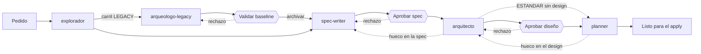

# Subagentes de planificación para OpenSpec

Cinco subagentes de Claude Code que llevan un pedido (un ticket, un mensaje, una idea) hasta un change de OpenSpec listo para implementar: spec y diseño aprobados por una persona, y `tasks.md` en grupos listos para el apply.

Cubren las fases **explore** y **propose** de OpenSpec. Las rondas de corrección son la fase **update**. El tramo de **apply** (implementación, revisión y cierre: `test-author`, `implementador`, `reviewer`, `security-reviewer` y `archivista`) se está construyendo en este mismo repo; su guion es [APLICACION.md](APLICACION.md) y sus fundaciones (modelo de git, control de alcance por agente) ya están — ver más abajo.

| Subagente | Fase | Skill que precarga | Escribe | Modelo |
|---|---|---|---|---|
| `explorador` | explore | `openspec-explore` | `impacto.md` | sonnet |
| `arqueologo-legacy` | propose del baseline | `openspec-propose`, `openspec-update-change` | proposal, specs y tests de caracterización | opus |
| `spec-writer` | propose, 1ª mitad | `openspec-propose`, `openspec-update-change` | proposal y specs | opus |
| `arquitecto` | propose, diseño | `openspec-propose`, `openspec-update-change` | design (y detecta huecos en la spec) | opus |
| `planner` | propose, plan | `openspec-propose`, `openspec-update-change` | tasks, en grupos por área, sin gate | sonnet |

## El flujo



- **El orquestador es la sesión principal de Claude Code**, siguiendo [ORQUESTACION.md](ORQUESTACION.md). Es el único que llama a los agentes, verifica lo que devuelven y frena en los gates.
- **Una persona interviene solo en los gates.** Lo que el pedido no define, los agentes no lo preguntan: lo resuelven con la opción más razonable y lo dejan como **decisión pendiente** para el gate siguiente.
- **El carril lo deciden las señales del explorador con reglas fijas**, y nunca baja. Por ejemplo, si toca un contrato, va como mínimo por COMPLETO, y si el área no tiene spec ni tests y el cambio la modifica, pasa primero por LEGACY. Los carriles, las señales, las reglas y qué corre cada carril están en [CARRILES.md](CARRILES.md), que es la única definición. El carril se recalcula después de Aprobar spec: si la spec aprobada revela un cambio BREAKING u otra señal, sube solo.
- **Si el pedido ya se cumple** (código y test que lo cubren), el explorador devuelve `YA_CUMPLE` con la evidencia. No se crea change ni se fija carril: el orquestador verifica la evidencia, te la muestra y termina.
- Cada agente termina con un **bloque JSON** de campos fijos, que el orquestador chequea antes de seguir. Máximo 3 correcciones por agente (rechazos y devoluciones por verificación) y 2 vueltas por hueco por change.

## Qué adapta cada agente de la skill oficial

Los agentes siguen la skill de OpenSpec de su fase. Su prompt dice solo qué cambia:
- **No hay una persona en la conversación.** Donde la skill dice preguntar, confirmar o esperar al usuario, el agente lo anota como pregunta abierta o decisión pendiente, o lo pone en el reporte.
- **Cada agente escribe solo sus artefactos**, aunque `openspec status` muestre el siguiente como `ready`.
- **En las rondas de corrección, el feedback del gate es la confirmación** que pide `openspec-update-change`.
- **Ninguno hace git:** el hook `sin-escritura.js` lo bloquea.

## El schema `spec-driven-agentes`

Es un fork de `spec-driven` (OpenSpec 1.16.1) con tres cambios:
- **`impacto` es el primer artefacto.** Lo escribe el explorador y el proposal depende de él.
- **design depende de specs**, porque el arquitecto diseña sobre la spec aprobada. Sigue siendo condicional: en COMPLETO se escribe siempre y en ESTANDAR solo si hace falta.
- **Las instrucciones de design y tasks ya no dicen "preguntale al usuario":** las dudas van a "Decisiones pendientes para Aprobar diseño".

El baseline del carril legacy usa `spec-driven` sin cambios, porque no pasa por el explorador.

`tasks.md` lo escribe el planner, después de Aprobar diseño y sin gate propio. Usa encabezados `## Grupo N: <título>` y marca el área de cada tarea, que es el formato que espera `/apply-grupo`; cada tarea cambia hasta unas 300 líneas y trae su comando de verificación, y lo que hay que hacer fuera del repo (por ejemplo, coordinar un cambio BREAKING) va en `## Workflow follow-up`.

## Instalación

Requisitos: [OpenSpec](https://github.com/Fission-AI/OpenSpec) 1.16 o posterior, inicializado en el proyecto con las skills de Claude (`openspec init --tools claude`), y Node.js para el hook.

```powershell
powershell -ExecutionPolicy Bypass -File scripts\install.ps1 -Proyecto C:\ruta\al\proyecto
```

El instalador copia:
- `agents/`, `hooks/` y `commands/` a `.claude/`.
- El schema a `openspec/schemas/`.
- `ORQUESTACION.md` y `CARRILES.md` a la raíz del proyecto.

No toca `openspec/config.yaml` ni `CLAUDE.md`. Al final lista lo que falta hacer a mano:
- En `openspec/config.yaml`: `schema: spec-driven-agentes`.
- En `CLAUDE.md`: que la sesión principal siga `ORQUESTACION.md` para todo pedido nuevo.

Las reglas del proyecto (stack, formato de errores, qué es BREAKING) van en el `context` de `openspec/config.yaml`, que todos los agentes leen.

## Uso

Con todo instalado, en una sesión nueva de Claude Code en el proyecto:

```text
/pedido <pegá el ticket o describí el cambio>
```

Por ejemplo, `/pedido Al dar de alta un cliente, recortar los espacios del nombre.` El pedido puede ocupar varias líneas. El comando (`commands/pedido.md`) le pasa el texto tal cual a la sesión y le indica que siga `ORQUESTACION.md` desde el principio, sin que tengas que escribirlo. También separa un pedido nuevo de las respuestas que das en los gates.

El orquestador corre el explorador, decide el carril y frena en cada gate. Para aprobar, respondé "aprobada". Para rechazar, escribí qué hay que cambiar. Al terminar, te dice cómo seguir con el apply.

### Sin terminal: `Orquestador.java`

`orquestador/Orquestador.java` recibe los pedidos y las decisiones como archivos en una bandeja y corre Claude Code sin interfaz (`claude -p`) en el proyecto. No decide nada del flujo: lanza `/pedido`, lee el bloque de estado con el que el orquestador cierra cada gate (ver "Bloque de estado al devolver el control" en `ORQUESTACION.md`) y, con cada decisión, retoma la misma sesión con `--resume`. Necesita Java 17 o más.

```text
java orquestador/Orquestador.java --proyecto C:/DEV/prueba-agentes --bandeja bandeja --vigilar
```

1. Dejá el pedido en `bandeja/entrada/<id>.txt`. El nombre es el id del pedido, por ejemplo `FAC-12.txt`; la primera línea puede ser `autor: ...`.
2. Cuando la corrida frena, leé `bandeja/gates/<id>-<n>.md`. Tiene lo que mostró el orquestador, en qué gate espera, el costo y los permisos que se negaron.
3. Respondé con un `.txt` en `bandeja/decisiones/`:

   ```text
   pedido: FAC-12
   gate: APROBAR_SPEC
   decision: rechazada
   El comentario va debajo y puede ocupar varias líneas.
   ```

   `decision` es `aprobada`, `rechazada` (con comentario) o, en una `ESCALADA`, `respuesta` (con texto). Una decisión para un gate que no es el que espera el pedido se descarta.

#### Fuente webhook (HTTP)

En vez de dejar archivos a mano, `--http <puerto>` levanta un webhook (con el `HttpServer` del JDK, sin dependencias) que recibe los pedidos y las decisiones por POST y los deja en la bandeja; de ahí los toma el mismo bucle. Es una fuente de entrada, como lo sería un webhook de Jira; la salida (los gates) sigue en archivos. Enciende `--vigilar` solo.

```text
java orquestador/Orquestador.java --proyecto C:/DEV/prueba-agentes --bandeja bandeja --http 8787
```

- `POST /pedido`: el cuerpo es el pedido (primera línea `autor:` opcional). El id va en el header `X-Pedido-Id`; si falta, se genera uno. Un id repetido responde 409.
- `POST /decision`: el cuerpo trae las cabeceras `pedido:`, `gate:`, `decision:` y el comentario, igual que un `.txt` de `decisiones/`.

```bash
curl -X POST http://127.0.0.1:8787/pedido -H "X-Pedido-Id: FAC-13" --data "Al dar de alta un cliente, recortar los espacios del nombre."
curl -X POST http://127.0.0.1:8787/decision --data $'pedido: FAC-13\ngate: APROBAR_SPEC\ndecision: aprobada'
```

**El orquestador corre en Sonnet por defecto.** Su trabajo (leer, verificar contra los archivos, aplicar las reglas fijas y escribir el gate) no necesita Opus, y Sonnet cuesta varias veces menos por token. Los subagentes que sí lo necesitan (arqueólogo, arquitecto) conservan su modelo por el frontmatter. Cambialo con `--modelo`.

El gate informa el **costo de esa corrida** y el **acumulado de la sesión**, como estimación a precio de lista: si `claude` entra con una suscripción, no se factura en dólares, pero el tope `--presupuesto` se mide contra ese número igual. `total_cost_usd` viene acumulado de toda la sesión (con `--resume`, cada corrida repite el gasto de los pasos anteriores), así que el costo de la corrida se calcula como cuánto subió el acumulado.

Los permisos de la corrida salen de `bandeja/claude-settings.json`, que se crea la primera vez con una lista base y se puede editar (o se pasa otro con `--permisos`). La lista incluye `javac` y `java` para que el arquitecto pueda compilar y correr un programa de prueba (su prompt lo permite, en un puerto propio), y `jps`/`netstat`/`taskkill` para que lo baje al terminar; el hook `sin-escritura.js` sigue bloqueando git. La corrida usa `--permission-mode acceptEdits`: lo que no está permitido se niega, y queda listado en el gate. Otras opciones: `--modelo`, `--presupuesto <usd>` (tope por corrida, 30 por defecto) y `--timeout <minutos>` (180).

## Validación

| Comando | Qué comprueba | Necesita |
|---|---|---|
| `node scripts/validar.js` | Frontmatter, skills y hook de cada agente; schema con `impacto` primero y sus templates; `CARRILES.md` con las señales y los 4 carriles, citado y no copiado; y que el JSON de ejemplo de cada agente traiga **exactamente** los campos de la tabla "Campos obligatorios" de `ORQUESTACION.md` y las señales de `CARRILES.md`. | Node |
| `node scripts/verificar-skills.js` | Que cada paso ("Paso 6") y sección ("Check for context") de una skill oficial que citan los agentes esté registrado en `scripts/skills-referenciadas.json`. | Node |
| `node --test scripts/test-hook.js` | Que `sin-escritura.js` bloquee `git commit`, `push`, `reset`, `checkout` y similares, deje pasar `openspec`, `git status` y `git diff`, y que con `--permitir-commit` deje `add`/`commit` pero siga bloqueando lo que integra o reescribe. | Node |
| `python scripts/test-check-agent-scope.py` | Que `check-agent-scope.py` traduzca bien los globs (`*` no cruza `/`, `**` sí) y que cada agente de apply solo matchee sus rutas. | Python |
| `node --test scripts/test-orquestador.js` | Que `Orquestador.java` lance `/pedido`, lea el bloque de estado, retome la misma sesión con cada decisión y descarte las que no corresponden, con un Claude Code falso (`pruebas/orquestador/claude-falso.js`). | Node y Java 17+ |
| `node scripts/verificar-skills.js --openspec` | Que esos pasos y secciones sigan existiendo, con el mismo título, en las skills que genera la CLI instalada. | OpenSpec |
| `node scripts/humo.js` | De punta a punta, en un proyecto temporal: `openspec init`, el instalador y su lista de pendientes, `openspec schema validate`, un change que arranca por `impacto` y valida sin design, el apply leyendo los `## Grupo N:`, y un baseline que valida y se archiva. | OpenSpec y PowerShell |

CI corre todo en cada push y PR, con la versión de OpenSpec registrada en `skills-referenciadas.json`. Un workflow semanal (`openspec-ultima.yml`) corre los chequeos de la CLI contra la última versión de OpenSpec, para enterarse antes de actualizar.

### Actualizar OpenSpec

1. Corré `node scripts/verificar-skills.js --openspec` con la versión nueva instalada. Si falla, revisá cada paso o sección que cambió y ajustá los prompts de los agentes.
2. Corré `node scripts/verificar-skills.js --openspec --actualizar`: registra los títulos nuevos y la versión, que es la que va a usar CI.
3. Corré `node scripts/humo.js`.

## Contenido

```
agents/        los cinco agentes de planificación (fuente de verdad)
schemas/       el schema spec-driven-agentes, con sus templates
hooks/         sin-escritura.js: bloquea git; con --permitir-commit deja commitear (tramo de apply)
commands/      /pedido: arranca el flujo con un pedido nuevo
ORQUESTACION.md  el guion que sigue la sesión principal en planificación
CARRILES.md    carriles, señales, reglas y qué corre cada carril
APLICACION.md  el guion del tramo de apply (implementación y cierre; en construcción)
orquestador/   Orquestador.java: pedidos y decisiones por bandeja, con claude -p
ci/            alcance-agentes.yml: workflow que corre el control de alcance en el proyecto
scripts/       instalador, validador, verificación de skills, tests del hook, control de alcance y humo
pruebas/humo/  fixtures de la prueba de humo: un change y un baseline mínimos
```

## Licencias

El schema es un fork de `spec-driven`, de [OpenSpec](https://github.com/Fission-AI/OpenSpec), bajo licencia MIT: ver [licenses/OpenSpec-MIT.txt](licenses/OpenSpec-MIT.txt).
