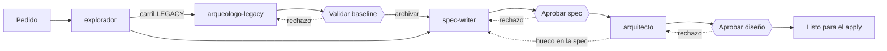

# Subagentes de planificación para OpenSpec

Cuatro subagentes de Claude Code que llevan un pedido (un ticket, un mensaje, una idea) hasta un change de OpenSpec listo para implementar: spec y diseño aprobados por una persona, y `tasks.md` en grupos listos para el apply.

Cubren las fases **explore** y **propose** de OpenSpec. Las rondas de corrección son la fase **update**. El apply y el verify quedan para otro tramo, por ejemplo [subagentesCC-openspec](https://github.com/Julian4Sagant/subagentesCC-openspec) con `/apply-grupo`.

| Subagente | Fase | Skill que precarga | Escribe | Modelo |
|---|---|---|---|---|
| `explorador` | explore | `openspec-explore` | `impacto.md` | sonnet |
| `arqueologo-legacy` | propose del baseline | `openspec-propose`, `openspec-update-change` | proposal, specs y tests de caracterización | opus |
| `spec-writer` | propose, 1ª mitad | `openspec-propose`, `openspec-update-change` | proposal y specs | opus |
| `arquitecto` | propose, 2ª mitad | `openspec-propose`, `openspec-update-change` | design y tasks | opus |

## El flujo



- **El orquestador es la sesión principal de Claude Code**, siguiendo [ORQUESTACION.md](ORQUESTACION.md). Es el único que llama a los agentes, verifica lo que devuelven y frena en los gates.
- **Una persona interviene solo en los gates.** Lo que el pedido no define, los agentes no lo preguntan: lo resuelven con la opción más razonable y lo dejan como **decisión pendiente** para el gate siguiente.
- **El carril lo deciden las señales del explorador con reglas fijas**, y nunca baja. Por ejemplo, si toca un contrato, va como mínimo por COMPLETO, y si el área no tiene spec ni tests y el cambio la modifica, pasa primero por LEGACY. Los carriles, las señales, las reglas y qué corre cada carril están en [CARRILES.md](CARRILES.md), que es la única definición.
- Cada agente termina con un **bloque JSON** de campos fijos, que el orquestador chequea antes de seguir. Máximo 3 rondas por agente.

## Qué adapta cada agente de la skill oficial

Los agentes siguen la skill de OpenSpec de su fase. Su prompt dice solo qué cambia:
- **No hay una persona en la conversación.** Donde la skill dice preguntar, confirmar o esperar al usuario, el agente lo anota como pregunta abierta o decisión pendiente, o lo pone en el reporte.
- **Cada agente escribe solo sus artefactos**, aunque `openspec status` muestre el siguiente como `ready`.
- **En las rondas de corrección, el feedback del gate es la confirmación** que pide `openspec-update-change`.
- **Ninguno hace git:** el hook `sin-escritura.js` lo bloquea.

## El schema `spec-driven-agentes`

Es un fork de `spec-driven` (OpenSpec 1.16.1) con tres cambios:
- **`impacto` es el primer artefacto.** Lo escribe el explorador y el proposal depende de él.
- **design depende de specs**, porque el arquitecto diseña sobre la spec aprobada. Sigue siendo condicional: en COMPLETO se escribe siempre y en ESTANDAR solo si hace falta.
- **Las instrucciones de design y tasks ya no dicen "preguntale al usuario":** las dudas van a "Decisiones pendientes para Aprobar diseño".

El baseline del carril legacy usa `spec-driven` sin cambios, porque no pasa por el explorador.

`tasks.md` usa encabezados `## Grupo N: <título>` y marca el área de cada tarea, que es el formato que espera `/apply-grupo`.

## Instalación

Requisitos: [OpenSpec](https://github.com/Fission-AI/OpenSpec) 1.16 o posterior, inicializado en el proyecto con las skills de Claude (`openspec init --tools claude`), y Node.js para el hook.

```powershell
powershell -ExecutionPolicy Bypass -File scripts\install.ps1 -Proyecto C:\ruta\al\proyecto
```

El instalador copia:
- `agents/` y `hooks/` a `.claude/`.
- El schema a `openspec/schemas/`.
- `ORQUESTACION.md` y `CARRILES.md` a la raíz del proyecto.

No toca `openspec/config.yaml` ni `CLAUDE.md`. Al final lista lo que falta hacer a mano:
- En `openspec/config.yaml`: `schema: spec-driven-agentes`.
- En `CLAUDE.md`: que la sesión principal siga `ORQUESTACION.md` para todo pedido nuevo.

Las reglas del proyecto (stack, formato de errores, qué es BREAKING) van en el `context` de `openspec/config.yaml`, que todos los agentes leen.

## Uso

Con todo instalado, en la sesión principal del proyecto:

```text
Pedido nuevo, seguí ORQUESTACION.md:
<pegá el ticket o describí el cambio>
```

El orquestador corre el explorador, decide el carril y frena en cada gate. Para aprobar, respondé "aprobada". Para rechazar, escribí qué hay que cambiar. Al terminar, te dice cómo seguir con el apply.

## Validación

```bash
node scripts/validar.js
```

Comprueba:
- El frontmatter de los agentes, las skills que precargan y el hook que declaran.
- Que los bloques JSON de ejemplo parseen y traigan todos los campos que chequea el orquestador.
- Que el schema tenga el artefacto `impacto` primero y todos sus templates.
- Que `CARRILES.md` tenga las 8 señales y los 4 carriles, y que el explorador, el arquitecto y `ORQUESTACION.md` lo citen sin copiar la tabla de señales.

CI lo corre en cada push y PR.

## Contenido

```
agents/        los cuatro agentes (fuente de verdad)
schemas/       el schema spec-driven-agentes, con sus templates
hooks/         sin-escritura.js: bloquea los comandos de git que cambian el repo
ORQUESTACION.md  el guion que sigue la sesión principal
CARRILES.md    carriles, señales, reglas y qué corre cada carril
scripts/       instalador y validador
```

## Licencias

El schema es un fork de `spec-driven`, de [OpenSpec](https://github.com/Fission-AI/OpenSpec), bajo licencia MIT: ver [licenses/OpenSpec-MIT.txt](licenses/OpenSpec-MIT.txt).
